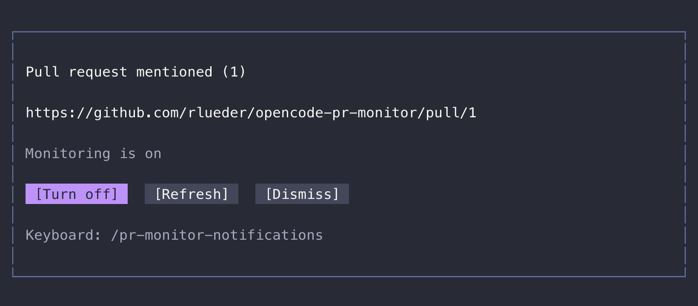

# OpenCode PR monitor

Keep a pull request moving without repeatedly asking your coding session to check
GitHub. This OpenCode V2 plugin watches CI failures, merge conflicts and new review
feedback, then queues a bounded repair request in the session that owns the PR.

Mention a PR URL in chat to show its controls. Monitoring stays **off until you
explicitly enable it**.



_Headless capture of the actual OpenTUI component with sample monitoring state
and a dark theme. The Turn off button is hovered. This is not a desktop capture._

## What it does

- **Clickable controls:** Turn on, Turn off, Refresh and Dismiss, with theme-aware
  hover, pressed and disabled states.
- **Session-bound monitoring:** checks the PR every 60 seconds while the server
  and project location remain loaded.
- **Background repair requests:** queues new failures, conflicts and eligible
  review feedback without interrupting an active turn.
- **Bounded activity:** persistent deduplication, backoff and repair budgets keep
  repeated events from becoming endless model calls.

The plugin itself only reads Git and GitHub. Your coding session performs any
repairs under its existing instructions and permissions. Enabling monitoring
does **not** authorize commits, pushes or auto-merge.

## Install

Requires OpenCode **V2**, macOS or Linux, Git, and an authenticated
[GitHub CLI](https://cli.github.com/) available to the OpenCode server. The plugin
is typechecked against `@opencode/plugin@2.1.4` and has been dogfooded on OpenCode
2.1.3. It does not support OpenCode V1.

Clone and install locally with Node 26.4+:

```sh
git clone https://github.com/rlueder/opencode-pr-monitor.git
cd opencode-pr-monitor
npm ci
gh auth status
```

If GitHub authentication is missing, run `gh auth login` yourself.

Merge the following into your project's `opencode.jsonc`, or into
`~/.config/opencode/opencode.jsonc` to make the plugin available globally.
Preserve existing settings and replace the installation path and repository name:

```jsonc
{
  "$schema": "https://opencode.ai/config.json",
  "plugins": ["/absolute/path/to/opencode-pr-monitor"],
  "permissions": [
    {
      "action": "pr-monitor.enable",
      "resource": "https://github.com/owner/repo/pull/*",
      "effect": "ask",
    },
  ],
}
```

The package includes a `./tui` companion. To explicitly load it in the terminal,
including when connected to a remote server, add the local package path to
`~/.config/opencode/cli.json` as well:

```jsonc
{
  "$schema": "https://opencode.ai/v2/cli.json",
  "plugins": ["/absolute/path/to/opencode-pr-monitor"],
}
```

The CLI path is local to the machine running the terminal; the server must also
have the server plugin installed. Configuration normally reloads automatically.
If an external source edit is not picked up, reopen the terminal. The plugin is
not published to npm.

## Use it

Mention a GitHub PR URL in a user, assistant or status message. Click **Turn on**
and approve the normal OpenCode permission request if prompted. The notification
reads actual server status before showing **Turn off**. **Dismiss** only hides
the notice; it does not stop monitoring.

A new message mentioning the same PR brings the notification back. Streaming
updates and replay of the same message do not duplicate it.

Keyboard commands work too:

```text
/pr-monitor on https://github.com/owner/repo/pull/42
/pr-monitor status
/pr-monitor off
```

Use `/pr-monitor-notifications` to choose a notification and act on it without
the mouse. To reopen one directly:

```text
/pr-monitor-notifications https://github.com/owner/repo/pull/42
```

That command only shows the controls; it does not enable monitoring.

## Limits and safety

- GitHub.com only, same-repository PRs, the `origin` remote and an exact checkout
  of the PR branch/head. Fork PRs and GitHub Enterprise are not supported.
- Monitoring stops on a merged/closed PR or an invalid session. The host and
  project location must stay loaded; this is not a durable cloud scheduler.
- Three repair attempts per head, twelve per binding, with a five-minute cooldown.
  Re-enabling explicitly resets the budgets and comment baseline.
- API snapshots fail closed if a connection exceeds 100 entries. Large PRs may
  need pagination support that is not implemented yet.
- Review feedback is untrusted input. Existing tool permissions still matter.
  No separate code-review model, auto-merge, rebase or force-push is added.
- These controls are for the full terminal UI, not desktop/web or OS toasts.
- If you also use `opencode-ghost-text`, v0.1.0's postprocessor can paint over
  overlays. Its scene-preview fix is needed; raising a notification's z-index
  alone cannot prevent a plugin from drawing onto the finished frame.

See [behavior and safety](docs/behavior.md) for eligibility, persistence,
cancellation and other operational details.

## Development

```sh
npm run check       # formatting, types and isolated unit tests
npm run test:ui     # actual OpenTUI rendering and mouse interaction, Bun 1.3.14+
npm run capture:toast
```

The capture script renders `NotificationView` with sample inputs, exports its
actual cell colors/text to SVG, and rasterizes a 2× PNG under `docs/images/`.
It does not read your screen or contact GitHub. Font rendering may vary by OS.
CI runs the unit and UI suites with Node 26 and Bun 1.3.14.

## License

[MIT](LICENSE).
